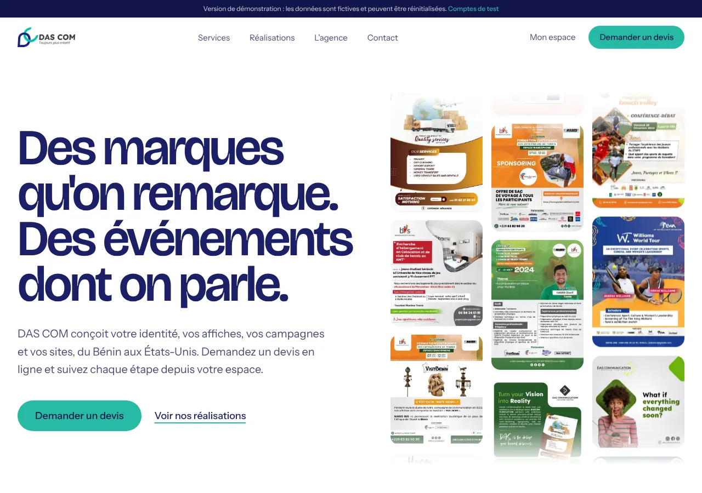
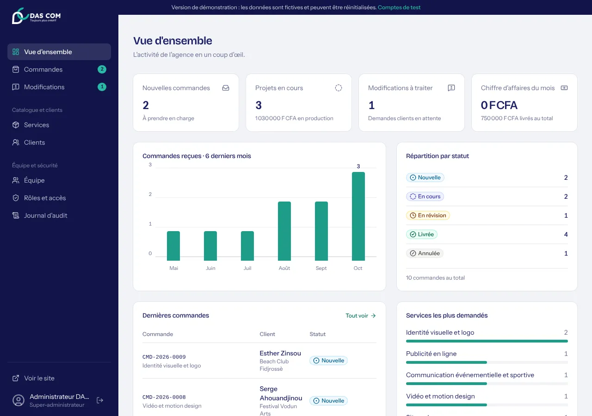
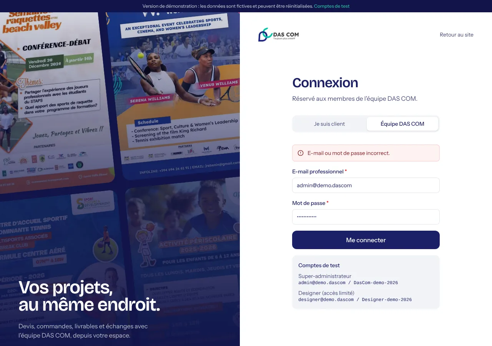
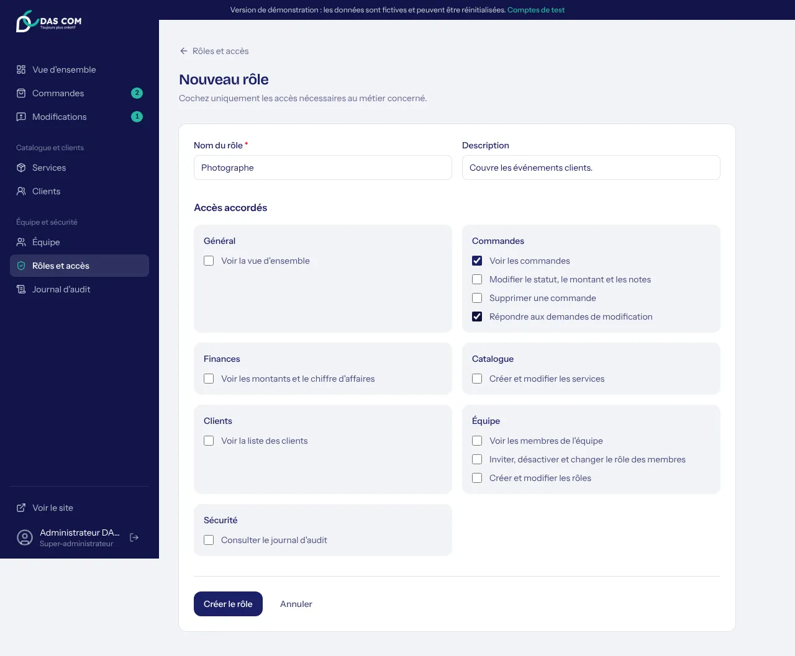
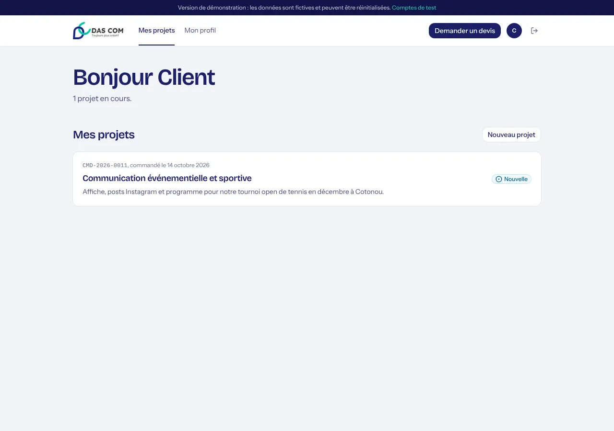

# DAS COM — plateforme de l'agence

Site, portfolio, espace client et dashboard de **DAS Communication** : marketing digital, design graphique, SEO, sites et applications, communication événementielle.



## Phase 1 : fondations (cette branche)

| Livré | Détail |
| --- | --- |
| **Nouveau design** | Typographie Bricolage Grotesque + Instrument Sans, indigo et teal du logo, mur d'affiches animé en ouverture, services en liste typographique, réalisations en mosaïque |
| **Base PostgreSQL** | Drizzle ORM, migrations versionnées. Sans configuration : PostgreSQL embarqué (PGlite) en mode démo |
| **Connexion Google** | Pour les clients (Auth.js v5). Le compte est créé à la première connexion |
| **Comptes équipe** | E-mail + mot de passe (scrypt), **double authentification** TOTP, blocage après 5 échecs |
| **Rôles et permissions** | 9 rôles par défaut (super-admin, chef de projet, commercial, comptable, designer, community manager, développeur, expert SEO, rédacteur) + rôles personnalisés ; 12 permissions vérifiées côté serveur |
| **Recrutement** | Invitation d'un membre par lien sécurisé (7 jours), choix du rôle et des compétences, désactivation |
| **Espace client** | Profil à compléter, liste des projets, devis pré-rempli, suivi de commande |
| **Dashboard** | Menu adapté au rôle, montants masqués sans accès finances, pages Équipe, Rôles, Clients, Journal d'audit, Mon compte |
| **Sécurité** | Journal d'audit, en-têtes HTTP de sécurité, jetons d'invitation hachés, redirections contrôlées |

<table>
<tr><td></td><td></td></tr>
<tr><td></td><td></td></tr>
</table>

## Démarrer en local (2 minutes, sans rien configurer)

```bash
npm install
npm run dev
```

Ouvrez http://localhost:3000. Sans `DATABASE_URL`, le **mode démo** s'active : la base est créée dans `.pglite/` avec des données fictives.

| Compte de test | Accès |
| --- | --- |
| `admin@demo.dascom` / `DasCom-demo-2026` | Super-administrateur |
| `designer@demo.dascom` / `Designer-demo-2026` | Designer : commandes et modifications uniquement |
| Bouton « Visiter l'espace client de démonstration » | Espace client (sans Google) |

## Mettre en production (Vercel)

1. **Base de données** : dans le projet Vercel → Storage → *Neon Postgres* (gratuit). `DATABASE_URL` est ajouté automatiquement.
2. **Variables** (Settings → Environment Variables), voir `.env.example` :
   - `AUTH_SECRET` : `npx auth secret`
   - `ADMIN_EMAIL` et `ADMIN_PASSWORD` : votre compte super-administrateur
   - `AUTH_GOOGLE_ID` et `AUTH_GOOGLE_SECRET` : identifiants OAuth Google
   - `NEXT_PUBLIC_SITE_URL` : l'adresse publique du site
3. **Google** : dans Google Cloud Console, créez un *ID client OAuth* (application Web) avec l'URI de redirection `https://VOTRE-DOMAINE/api/auth/callback/google`.
4. Déployez. Le script `vercel-build` applique les migrations et crée le super-administrateur avant le build.

> Sans `DATABASE_URL`, un déploiement Vercel fonctionne aussi, en **mode démo** : pratique pour prévisualiser, mais les données sont temporaires et propres à chaque instance.

## Scripts

| Commande | Effet |
| --- | --- |
| `npm run dev` | Développement |
| `npm run build` / `npm start` | Production |
| `npm run lint` / `npm run typecheck` | Vérifications |
| `npm run db:generate` | Génère une migration après modification de `src/db/schema.ts` |
| `npm run db:setup` | Applique les migrations et les données initiales sur `DATABASE_URL` (`-- --demo` pour ajouter les données fictives) |

## Structure

```
src/
├── auth.ts, auth.config.ts   Auth.js : Google, équipe (mot de passe + 2FA), démo
├── proxy.ts                  Redirections rapides (dashboard, espace, connexion)
├── actions/                  Server Actions : public, auth, compte, équipe, admin
├── app/
│   ├── (site)/               Site public, devis, suivi, réalisations
│   ├── connexion/            Connexion client / équipe
│   ├── invitation/[jeton]/   Activation d'un compte équipe
│   ├── espace/               Espace client
│   └── dashboard/            Back-office (équipe, rôles, clients, journal…)
├── db/                       Schéma, migrations embarquées, données initiales
├── data/realisations.ts      Portfolio
└── lib/                      Permissions, sessions, 2FA, audit, validations
```

## Phases suivantes

2. Réalisations en **packages par type d'événement** avec déclinaisons, blog
3. **Devis** PDF signés en ligne, livrables, révisions
4. **Paiements** Mobile Money (FedaPay / KkiaPay) et carte (Stripe), factures
5. **Eury** (assistante IA), chat en direct, notifications e-mail / WhatsApp
6. Avis clients, recrutement avancé (offres, candidatures), affectation des projets aux membres
7. Tests de bout en bout automatisés, performance, documentation
